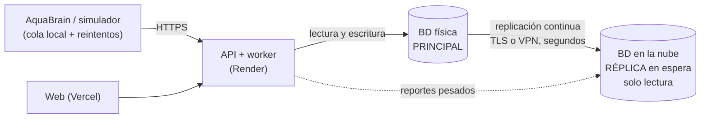

# Base de datos física con réplica en la nube (diseño, D-34)

> **Estado:** diseño para una etapa posterior. Hoy la base principal está en la nube (Supabase + Neon, D-30) y **no hay servidor físico**. Este documento describe cómo se agregaría uno y qué pasa si falla.

## 1. Arquitectura propuesta

- **Funcionamiento normal:** todas las escrituras van a la base **física**. PostgreSQL envía cada cambio a la **réplica en la nube** mediante *streaming replication* asíncrona, con unos segundos de atraso.
- La réplica también puede atender consultas pesadas de solo lectura (exportaciones, comparaciones de históricos) sin cargar al servidor principal.
- La API llega a la base por un **nombre fijo** (por ejemplo `bd.aquaplants.cl`). El driver `pg` de Node no acepta varias direcciones, así que el cambio de servidor se hace con DNS o con un proxy (HAProxy o PgBouncer). Como alternativa, se cambia `DATABASE_URL` en Render y se redespliega.

## 2. Qué pasa si el servidor físico falla

| Componente | Sin réplica | Con réplica en la nube |
|---|---|---|
| API | Responde error; `/health` informa `postgresql: error` | Vuelve a funcionar al promover la réplica |
| Usuarios | No pueden iniciar sesión ni ver datos | Pierden el servicio solo mientras dura el cambio |
| AquaBrain | La API rechaza la telemetría; el dispositivo **guarda en su cola local y reintenta** (estado «sincronizando»). No hay pérdida mientras la cola tenga espacio | Igual, y al terminar el cambio reenvía lo acumulado |
| Alertas y correos | **Se detienen**: una alerta crítica durante la caída no avisa a nadie | Se reanudan; el worker procesa las alertas pendientes y envía los correos atrasados |
| Datos | Si el disco se daña, se pierde lo que no esté en otro lugar | Solo se pierden los segundos sin replicar, y el AquaBrain los reenvía |

**Por qué reenviar no duplica datos** (ya está implementado):
- las mediciones se insertan con `ON CONFLICT (id_sensor, ts) DO NOTHING`;
- los lotes con `ON CONFLICT (id_lote)`;
- los eventos del dispositivo con `(id_dispositivo, id_evento_local)`.

La página Continuidad muestra los lotes recuperados y los duplicados descartados.

## 3. Procedimiento de conmutación (*failover*)

1. **Detectar.** Un chequeo cada minuto al servidor físico, o `/health` con `postgresql: error` durante 3 chequeos seguidos.
2. **Confirmar** que el servidor físico de verdad no responde, para no tener dos principales a la vez (*split-brain*). Si vuelve a medias, se aísla, por ejemplo apagando su servicio o cerrando el puerto.
3. **Promover** la réplica de la nube a principal: `pg_ctl promote`, o `SELECT pg_promote();`.
4. **Redirigir** la API: cambiar el DNS o el proxy, o `DATABASE_URL` en Render.
5. **Verificar:** `/health` en `ok`, que la telemetría vuelva a entrar y que la cola de los AquaBrain baje a cero en la página Continuidad.
6. **Avisar** al Administrador y registrar el incidente.

| Indicador | Cambio manual | Cambio automático (Patroni o similar) |
|---|---|---|
| **RPO** (datos que se pueden perder) | Segundos (lo no replicado); en la práctica 0, porque el AquaBrain reenvía | Igual |
| **RTO** (tiempo sin servicio) | 5–15 min | < 1 min |

## 4. Regreso al servidor físico (*failback*)

1. **No** se vuelve a usar el servidor físico apenas encienda: tiene datos atrasados.
2. Se reconstruye como **réplica de la nube** (`pg_rewind`, o una copia nueva con `pg_basebackup`) y se espera a que esté al día.
3. En un horario de poca actividad se repite el procedimiento al revés: promover el servidor físico y redirigir la API.
4. La nube vuelve a ser la réplica en espera.

## 5. Requisitos y cuidados

- **Misma versión de PostgreSQL y mismas extensiones en ambos lados.** La replicación física copia el disco tal cual. Si el servidor físico usa TimescaleDB, la nube también debe tenerlo.
- **Supabase no puede ser réplica física** de un servidor externo. La réplica en espera tendría que ser una **VM con PostgreSQL** (AWS, Azure, Google Cloud o DigitalOcean) o un servicio que admita réplica externa. La replicación lógica (por tabla) hacia Supabase es posible, pero es más frágil: no copia cambios de esquema ni secuencias.
- **Canal seguro:** la replicación va por TLS (`hostssl` en `pg_hba.conf`) o por una VPN, con un usuario dedicado que solo tenga el permiso `REPLICATION`.
- **Monitorear el atraso de la réplica:** `pg_stat_replication` (`replay_lag`). Si supera, por ejemplo, 60 s, se avisa al Administrador.
- **Neon (payloads originales):** sigue en la nube y no depende del servidor físico. Si fallara, la API ya guarda los payloads en una bandeja de salida (*outbox*) y los reintenta.

## 6. Cómo explicarlo en la presentación

> «La base principal estaría en un servidor físico, con una réplica en la nube que recibe cada cambio en segundos. Si el servidor físico falla, promovemos la réplica y la API pasa a la nube en minutos. Mientras tanto, los AquaBrain guardan sus mediciones y las reenvían, y el sistema descarta duplicados, así que no se pierden datos. Cuando el servidor físico vuelve, primero se sincroniza desde la nube y después se regresa.»
